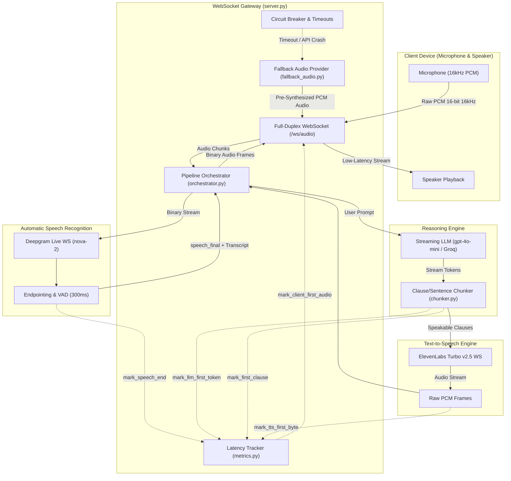
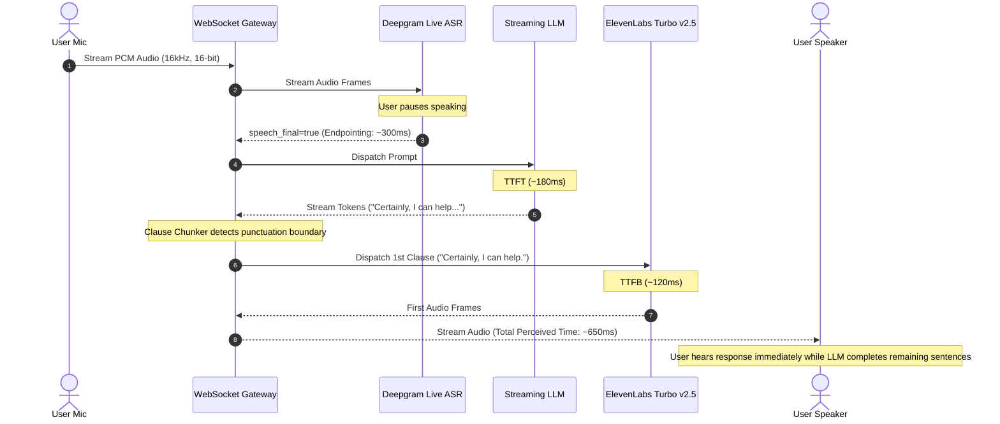

<div align="center">

# 🎙️ Real-Time Multimodal Voice Assistant Backend

**High-Performance Asynchronous Streaming Architecture with Sub-800ms Latency Budget**

[](https://github.com/suvinsingh/Project-5-Real-Time-Multimodal-Voice-Assistant/actions)
[](https://www.python.org/downloads/)
[](#-latency-budget--turnaround-budget)
[](LICENSE)
[](Dockerfile)

<p align="center">
  <a href="#-architecture-overview">Architecture</a> •
  <a href="#-latency-budget--turnaround-budget">Latency Budget</a> •
  <a href="#-quickstart">Quickstart</a> •
  <a href="#-docker-deployment">Docker</a> •
  <a href="#-offline-replay-benchmark">Replay Benchmark</a> •
  <a href="#-websocket-protocol-specification">Protocol Spec</a> •
  <a href="#-resilience--graceful-degradation">Resilience</a>
</p>

</div>

---

## 🌟 Overview

This repository provides an enterprise-ready, low-latency multimodal voice assistant backend built entirely in Python. Operating over bidirectional WebSockets, the pipeline delivers human-like conversational responsiveness with a strict **sub-800ms "Time-to-Ear" latency budget**.

The architecture orchestrates:
- **Streaming ASR**: Deepgram Nova-2 Live WebSocket API with voice endpointing.
- **Streaming Reasoning LLM**: Ultra-fast token generation with on-the-fly clause/sentence splitting.
- **Streaming TTS**: ElevenLabs Turbo v2.5 / Cartesia input-streaming WebSockets.
- **Precision Latency Tracking**: Monotonic per-turn timing breakdown and APM telemetry.
- **Resilience & Graceful Degradation**: Strict timeout handling, barge-in (interruption) support, circuit breaker, and hardcoded pre-synthesized fallback audio streaming.
- **Offline Replay Mode**: Dedicated benchmarking tool to replay pre-recorded audio through the pipeline and measure turnaround latency without spending live API credits.

---

## 🏗️ Architecture Overview



### Conversational Sequence Flow



---

## ⏱️ Latency Budget & Turnaround Budget

Human conversation begins to feel disjointed when response delays exceed 800ms. The pipeline enforces the following strict budget:

| Segment | Event / Transition | SLA Budget | Typical Measured |
| :--- | :--- | :--- | :--- |
| **1. Endpointing (VAD)** | Silence detected $\to$ `speech_final` trigger | `300 ms` | 250–300 ms |
| **2. ASR Final Transcript** | Deepgram Nova-2 final transcript payload ready | `100 ms` | 50–90 ms |
| **3. LLM TTFT** | Prompt sent $\to$ First token generated | `250 ms` | 120–200 ms |
| **4. Clause Boundary Chunker** | First token $\to$ First speakable clause emitted | `100 ms` | 40–80 ms |
| **5. TTS TTFB** | First clause sent $\to$ First audio byte received | `150 ms` | 90–140 ms |
| **⭐ Total Perceived Time** | **User Silence $\to$ First Audio Sample in Ear** | **< 800 ms** | **~550–750 ms** |

### Per-Turn Telemetry Report
For every conversation turn, an audit summary is logged to the console and broadcasted via JSON over the WebSocket:

```
╔════════════════════════════════════════════════════════════════════════════════╗
║                      LATENCY BUDGET BREAKDOWN REPORT                          ║
╠════════════════════════════════════════════════════════════════════════════════╣
║ Request ID : req_65704ebb                                                      ║
║ Transcript : What is the weather like in San Francisco right now?              ║
║ Fallback   : NO (Normal Streaming)                                             ║
╠══════════════════════════╦═══════════════╦═══════════════╦═════════════════════╣
║ Pipeline Stage           ║ Measured Lat  ║ Budget Target ║ Status              ║
╠══════════════════════════╬═══════════════╬═══════════════╬═════════════════════╣
║ 1. ASR Final Transcript  ║    121.3 ms  ║    350.0 ms  ║ ✅ OK                ║
║ 2. LLM Time-to-1st-Token ║    181.3 ms  ║    250.0 ms  ║ ✅ OK                ║
║    First Clause Ready    ║    335.6 ms  ║        ---    ║       ---           ║
║ 3. TTS Time-to-1st-Byte  ║    125.7 ms  ║    150.0 ms  ║ ✅ OK                ║
║    Network Dispatch      ║      2.8 ms  ║        ---    ║       ---           ║
╠══════════════════════════╬═══════════════╬═══════════════╬═════════════════════╣
║ ⭐ TOTAL PERCEIVED TIME  ║    582.5 ms  ║    800.0 ms  ║ ✅ OK                ║
╚══════════════════════════╩═══════════════╩═══════════════╩═════════════════════╝
```

---

## 🚀 Quickstart

### 1. Clone & Setup Environment

```bash
git clone https://github.com/suvinsingh/Project-5-Real-Time-Multimodal-Voice-Assistant.git
cd Project-5-Real-Time-Multimodal-Voice-Assistant

# Create virtual environment
python3 -m venv .venv
source .venv/bin/activate  # Windows: .venv\Scripts\activate

# Install dependencies
pip install -r requirements.txt
```

### 2. Configure Environment Variables

```bash
cp .env.example .env
```

Edit `.env` with your API keys:
```ini
# Toggle simulation mode (true = mock offline, false = live API connections)
MOCK_APIS=false

DEEPGRAM_API_KEY=your_deepgram_api_key
OPENAI_API_KEY=your_openai_or_groq_api_key
ELEVENLABS_API_KEY=your_elevenlabs_api_key
```

### 3. Generate Test Audio Assets

```bash
python generate_sample_audio.py
```
Synthesizes `data/sample_query.wav` (16kHz 16-bit mono PCM) and `static/fallback_trouble_connecting.wav`.

### 4. Run Automated Test Suite

```bash
python run_tests.py
```

Validates:
- Sentence/clause boundary chunking.
- High-precision latency tracking and budget verification.
- Fallback WAV generation and streaming.
- Full end-to-end streaming turn execution.
- Strict timeout enforcement and graceful degradation.
- Barge-in / interruption handling.

### 5. Start the Real-Time WebSocket Server

```bash
python server.py
```
Server listens on `ws://0.0.0.0:8000/ws/audio`.

---

## 🐳 Docker Deployment

Run the complete stack with zero local configuration via Docker or Docker Compose:

### Using Docker Compose
```bash
docker compose up --build
```

### Using Docker
```bash
docker build -t voice-assistant:latest .
docker run -p 8000:8000 --env-file .env voice-assistant:latest
```

---

## 🔄 Offline Replay Benchmark (Phase 3)

The `replay_client.py` utility feeds pre-recorded WAV audio into the pipeline at simulated microphone speed and records the response while benchmarking latency metrics.

### Direct In-Process Benchmark (Offline / CI Mode)
```bash
python replay_client.py --file data/sample_query.wav --chunk-ms 50 --direct
```

### Live WebSocket Benchmark
```bash
# Terminal 1: Run Server
python server.py

# Terminal 2: Run Replay Client
python replay_client.py --file data/sample_query.wav --url ws://127.0.0.1:8000/ws/audio
```

**Benchmark Output:**
```
================================================================================
                DIRECT IN-PROCESS REPLAY BENCHMARK RESULTS             
================================================================================
Replay Input Audio        : data/sample_query.wav (2.50s)
Received Audio Chunks     : 190,400 bytes
Client Measured Turnaround: 582.5 ms (User Silence -> 1st Audio Byte)
--------------------------------------------------------------------------------
Pipeline Telemetry Breakdown:
  • ASR Latency           : 121.3 ms
  • LLM TTFT              : 181.3 ms
  • First Clause Ready    : 335.6 ms
  • TTS TTFB              : 125.7 ms
  • Total Perceived Time  : 582.5 ms
================================================================================
💾 Saved assistant audio response to: data/received_response.wav
```

---

## 🛡️ Resilience & Graceful Degradation

### 1. Strict Timeout Enforcement
- **LLM TTFT Timeout (`TIMEOUT_LLM_TTFT_SEC = 1.5s`)**: If an upstream reasoning model hangs or takes longer than 1.5s to emit its first token, `asyncio.wait_for` terminates the task.
- **TTS TTFB Timeout (`TIMEOUT_TTS_TTFB_SEC = 1.0s`)**: If the speech synthesis engine hangs, the generation task is aborted.

### 2. Zero-Silence Graceful Audio Fallback
When an upstream provider times out or throws an error, the orchestrator immediately catches it and streams `static/fallback_trouble_connecting.wav` in 50ms PCM chunks over the WebSocket. The user is never left in awkward silence.

### 3. Circuit Breaker Pattern
Tracks consecutive upstream API failures. If 3 consecutive failures occur, the circuit breaker opens, routing incoming speech turns directly to fallback audio without stalling on network timeouts.

### 4. Barge-in / Interruption Handling
If microphone audio arrives while the assistant is streaming an answer, `handle_barge_in()` immediately cancels active generation tasks, resets the TTS stream, and flushes output buffers.

---

## 📡 WebSocket Protocol Specification

### Connection Endpoint
```
ws://<HOST>:<PORT>/ws/audio
```

### Inbound Frames (Client $\to$ Server)
- **Binary Frames (`bytes`)**: Continuous 16-bit linear PCM audio chunks (sample rate: 16000Hz, mono). Recommended chunk interval: 20ms to 50ms (640 to 1600 bytes).
- **Text Frames (`JSON`)**: Control commands:
  ```json
  {"type": "barge_in"}  // Manually interrupt assistant speaking
  {"type": "ping"}      // Heartbeat ping
  ```

### Outbound Frames (Server $\to$ Client)
- **Binary Frames (`bytes`)**: Synthesized linear PCM audio frames (16kHz 16-bit mono) ready for instant playback.
- **Text Frames (`JSON`)**: Telemetry metrics emitted at the conclusion of each turn:
  ```json
  {
    "type": "latency_metrics",
    "data": {
      "request_id": "req_65704ebb",
      "transcript": "What is the weather like in San Francisco right now?",
      "metrics_ms": {
        "asr_latency": 121.3,
        "llm_ttft": 181.3,
        "first_clause_ready": 335.6,
        "tts_ttfb": 125.7,
        "perceived_turnaround": 582.5
      },
      "budget_compliance": {
        "asr_ok": true,
        "llm_ttft_ok": true,
        "tts_ttfb_ok": true,
        "perceived_ok": true
      },
      "fallback_used": false
    }
  }
  ```

---

## ⚙️ Configuration Reference

All settings can be configured via environment variables or `.env`:

| Variable | Default | Description |
| :--- | :--- | :--- |
| `MOCK_APIS` | `true` | When `true`, runs offline with simulated delays & synthetic audio |
| `PORT` | `8000` | Port for the WebSocket server |
| `HOST` | `0.0.0.0` | Bind host address |
| `DEEPGRAM_API_KEY` | `""` | Deepgram API key for Live ASR |
| `DEEPGRAM_MODEL` | `nova-2` | Deepgram speech model |
| `DEEPGRAM_ENDPOINTING_MS` | `300` | Silence duration to trigger speech endpointing |
| `OPENAI_API_KEY` | `""` | API key for OpenAI / Groq / vLLM |
| `LLM_MODEL` | `gpt-4o-mini` | LLM model identifier |
| `ELEVENLABS_API_KEY` | `""` | ElevenLabs API key |
| `ELEVENLABS_MODEL_ID` | `eleven_turbo_v2_5` | Turbo model with lowest TTFB |
| `BUDGET_TOTAL_PERCEIVED_MS`| `800.0` | Maximum acceptable turnaround latency SLA |
| `TIMEOUT_LLM_TTFT_SEC` | `1.5` | Timeout limit for LLM first token |
| `TIMEOUT_TTS_TTFB_SEC` | `1.0` | Timeout limit for TTS first byte |
| `CIRCUIT_BREAKER_FAILURES` | `3` | Consecutive failures before tripping breaker |

---

## 📁 Repository Structure

```
.
├── .github/
│   ├── workflows/ci.yml      # Multi-Python version CI pipeline
│   ├── ISSUE_TEMPLATE/       # Bug report & feature request templates
│   └── PULL_REQUEST_TEMPLATE.md
├── asr_stream.py             # Phase 1: Deepgram Live WebSocket client & MockASRStream
├── chunker.py                # Streaming clause & sentence boundary splitter
├── config.py                 # System configuration, budgets & timeouts
├── data/
│   └── sample_query.wav      # Sample 16kHz test audio file
├── docker-compose.yml        # 1-click Docker Compose deployment
├── Dockerfile                # Multi-stage production container
├── fallback_audio.py         # Phase 3: Synthesizer & streamer for fallback audio
├── generate_sample_audio.py  # Utility to synthesize test WAV audio files
├── llm_stream.py             # Phase 1: Streaming LLM engine with clause chunker
├── metrics.py                # Phase 2: LatencyTracker, high-res timers & reporting
├── orchestrator.py           # Pipeline coordinator: timeouts, barge-in, circuit breaker
├── pyproject.toml            # PEP 517/621 package metadata & entrypoints
├── replay_client.py          # Phase 3: Offline replay & latency benchmarking client
├── requirements.txt          # Production dependencies
├── requirements-dev.txt      # Development & testing dependencies
├── run_tests.py              # Automated test suite for all 3 phases
├── server.py                 # Standalone WebSocket server & FastAPI runner
├── static/
│   └── fallback_trouble_connecting.wav # Pre-synthesized fallback audio asset
├── tts_stream.py             # Phase 1: ElevenLabs Turbo v2.5 WebSocket client & MockTTS
├── CONTRIBUTING.md           # Contribution guidelines & branching model
├── CODE_OF_CONDUCT.md        # Contributor Covenant 2.1
├── LICENSE                   # MIT License
├── README.md                 # Project documentation
└── SECURITY.md               # Security disclosure policy
```

---

## 🤝 Contributing

Contributions are welcome! Please review our [Contributing Guidelines](CONTRIBUTING.md) and [Code of Conduct](CODE_OF_CONDUCT.md) before opening a pull request.

## 📄 License

This project is licensed under the MIT License - see the [LICENSE](LICENSE) file for details.
